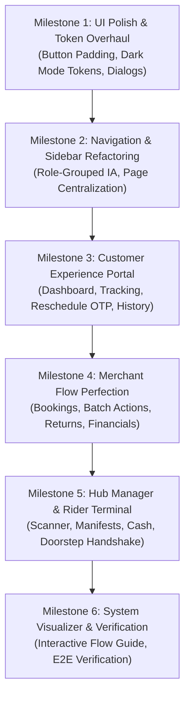

# Dhruto Master System Overhaul & Role Experience Architecture

> **Single Source of Truth** for End-to-End Workflows, Customer Portal, Centralized Navigation & UI Design Standards.

---

## 1. Executive Summary & Goals

This document lays out the comprehensive overhaul of the Dhruto Logistics Platform addressing four critical pillars:

1. **UI Design Excellence & Defect Elimination**:
   - Resolve button clipping and missing horizontal padding caused by undefined spacing tokens.
   - Resolve text invisibility in Dark Mode by providing complete high-contrast `.dark` theme CSS variables.
   - Upgrade modal dialogs into modern, responsive, high-elevation surfaces with distinct header icon badges and mobile-friendly tap targets.
   - Ensure interfaces are smooth, clean, modern, and interactive—avoiding generic or repetitive ("same same") layouts.

2. **Information Architecture & Sidebar Refactoring**:
   - De-clutter the sidebar across all roles (especially Merchant) by categorizing routes into logical operational groups (`Operations`, `Finance & Intelligence`, `Tools & Settings`).
   - Move granular actions (e.g. New Booking, Batch Actions, Returns filter) into context-rich sub-tabs and action bars directly inside dedicated pages.

3. **Complete Customer Portal (`/customer/*`)**:
   - Provide a first-class, dedicated Customer Portal for the `CUSTOMER` role.
   - Features include: Live Delivery Dashboard, Secure Delivery OTP display, Delivery Reschedule & Rider Note modal, Order History with Proof-of-Delivery details, and Saved Delivery Preferences.

4. **Transparent End-to-End Role Lifecycle & Visualizer**:
   - Detail and verify step-by-step lifecycles for all 5 roles: Customer, Merchant, Hub Manager, Rider, and Admin.
   - Provide an interactive Workflow & Operations Guide in the platform for operators and users.

---

## 2. Six-Milestone Execution Roadmap

### Milestone 1: UI Polish, Dark Tokens & Dialog Modernization
- **Button Component Fixes** ([`packages/ui/src/components/button.tsx`](file:///c:/Sofof_tech_2026/dhruto/packages/ui/src/components/button.tsx)):
  - Fix `px-4.5` Tailwind omission by standardizing `px-4 sm:px-5` and defining `4.5` in spacing preset.
  - Add `shrink-0` on button icons, avoid flex-child truncation, ensure responsive touch targets.
- **Dark Mode Color System** ([`packages/ui/src/styles/tokens.css`](file:///c:/Sofof_tech_2026/dhruto/packages/ui/src/styles/tokens.css)):
  - Define complete `.dark` block: dark surface (`hsl(222 47% 8%)`), crisp foreground (`hsl(210 40% 98%)`), elevated dark cards, muted borders, and legible secondary text (`hsl(215 20% 75%)`).
- **Modal Dialog Redesign** ([`packages/ui/src/components/dialog.tsx`](file:///c:/Sofof_tech_2026/dhruto/packages/ui/src/components/dialog.tsx) & [`apps/web-merchant/components/confirm-dialog.tsx`](file:///c:/Sofof_tech_2026/dhruto/apps/web-merchant/components/confirm-dialog.tsx)):
  - Backdrop blur, refined glass borders, subtle shadows, clear header icons, accessible titles, full-width actions on mobile.

### Milestone 2: Navigation & Information Architecture Overhaul
- **Centralized Grouping in `NAV_BY_ROLE`** ([`apps/web-merchant/config/navigation.ts`](file:///c:/Sofof_tech_2026/dhruto/apps/web-merchant/config/navigation.ts)):
  - `Operations`: Overview, Shipments, Returns Hub.
  - `Finance & Intelligence`: Financials & COD, Analytics, Risk Intelligence.
  - `Tools & Settings`: Developer & Webhooks, Rate Calculator, Settings.
- **Page Centralization**:
  - Keep primary entry points clean; move sub-workflows (e.g. New Booking, Batch Actions) to top action bars in the Shipments view.

### Milestone 3: Dedicated Customer Experience Portal
- **Routing & RBAC Configuration**:
  - Add `CUSTOMER_ROUTES` to [`config/routes.ts`](file:///c:/Sofof_tech_2026/dhruto/apps/web-merchant/config/routes.ts) (`/customer/dashboard`, `/customer/track`, `/customer/history`, `/customer/settings`).
  - Add `customer` to `AppSection` and configure `ROLE_CONFIG.CUSTOMER` in [`config/roles.ts`](file:///c:/Sofof_tech_2026/dhruto/apps/web-merchant/config/roles.ts).
  - Add `NAV_BY_ROLE.CUSTOMER` and `BOTTOM_HREFS.CUSTOMER` in [`config/navigation.ts`](file:///c:/Sofof_tech_2026/dhruto/apps/web-merchant/config/navigation.ts).
- **Customer Pages & Components** (`apps/web-merchant/app/[locale]/(customer)/customer/`):
  - **Dashboard**: Active Deliveries card, Live Status Timeline, Rider Contact & Map preview, Secure Delivery OTP card.
  - **Reschedule & Instructions Modal**: Allow recipient to choose preferred delivery date/time and special instructions (e.g., "Leave at security", "Call on arrival").
  - **History**: Completed shipments with digital proof of delivery.
  - **Settings**: Primary address, phone number, and SMS/WhatsApp notifications.

### Milestone 4: Merchant Flow Perfection
- **Shipments Page Sub-Tabs & Actions**:
  - Action header with "New Parcel Booking" modal/link and "Batch Actions" dropdown.
  - Filter pills (All, In Transit, Pending Pickup, Returns, Delivered).
- **Returns Hub & Risk Review Integration**:
  - Seamless jump from high-risk alerts to review queue and reverse pickups.

### Milestone 5: Hub Manager & Rider Field Operations [COMPLETED]
- **Hub Manager Navigation & Operations Pipeline**:
  - Restructured Hub navigation into 3 clean groups: `Operations & Inbound` (Dashboard, Continuous Scanner, Floor Inventory), `Consolidation & Dispatch` (Destination Bags, Linehaul Manifests), `Audit & Reconciliation` (Exceptions, Cash Desk).
  - Added interactive **5-Stage Hub Operations Pipeline** on [`HubDashboardView`](file:///c:/Sofof_tech_2026/dhruto/apps/web-merchant/features/hubs/components/hub-dashboard-view.tsx): Inbound Scans -> Sorting & Bags -> Linehaul Manifests -> Last-Mile Inventory -> Cash Desk & Audit with live metrics and direct actions.
  - Added interactive **Shift SOP (Standard Operating Procedures) Guide** covering Morning Linehaul Arrival, Mid-day Sorting/Tamper-Seal Bagging, and Evening Rider Cash Hand-In.
- **Rider Terminal & Shift Cockpit**:
  - Restructured Rider navigation into 3 clean groups: `Shift & Runsheet` (Cockpit, Tasks Runsheet), `Performance & History` (Delivery History), `Account` (Profile, Shift Settings).
  - Added **Daily Runsheet Progress & Completion Tracker** on [`RiderDashboard`](file:///c:/Sofof_tech_2026/dhruto/apps/web-merchant/features/riders/components/rider-dashboard.tsx): Live progress bar (% completed, total assigned vs delivered), remaining COD to collect, and quick jump buttons.
  - Added **Doorstep Delivery & Safety SOP Handbook**: 4-step checklist covering GPS Navigation, 6-Digit OTP Handshake, Exact COD Collection, and Hub Cash Hand-In.
  - Polished [`TaskDetailsView`](file:///c:/Sofof_tech_2026/dhruto/apps/web-merchant/features/riders/components/task-details-view.tsx): Recipient 6-digit OTP guidance, quick cash tender shortcuts (`Exact`, `+50`, `+100`), and failure dialog.

### Milestone 6: System Visualizer & End-to-End Verification
- **Operations & Workflow Guide Component**:
  - Visual, interactive roadmap showing all 5 user roles, their lifecycles, and state machine transitions.
- **Verification**:
  - Full TypeScript build check (`pnpm turbo run build / typecheck`).
  - Unit tests suite verification (148+ tests passing).

---

## 3. Strict Quality & Architectural Guidelines
- **Zero Build Errors**: Always ensure strict TypeScript compatibility; zero unused imports or variables (`TS6133`).
- **Preserve Custom Toasts**: Maintain custom Sonner toast styling in `toast.css` (flat, borderless, no gradient, vertically centered close icon, top-center).
- **Design Tokens**: Never use hardcoded raw colors; use semantic tokens (`bg-surface`, `text-foreground`, `text-muted-foreground`, `border-border`).
