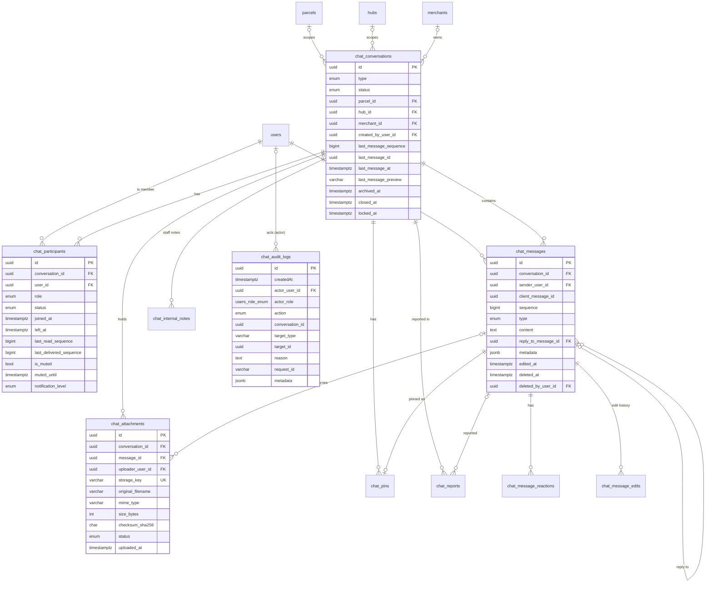

# Communication Platform — Database Design

Migration: `apps/api/src/database/migrations/1700000000010-CommunicationPhase1Foundation.ts`
Entities: `apps/api/src/database/entities/Chat*.entity.ts`

## 1. Entity relationships



Every table except `chat_audit_logs` also has `createdAt` / `updatedAt` (`BaseEntity`). `chat_message_reactions`, `chat_message_edits`, `chat_pins`, `chat_reports`, and `chat_internal_notes` are left out of the diagram's attribute lists for brevity. Their columns are in §2.

## 2. Tables

| Table                    | Purpose                                                                  | Key columns / rules                                                                                                                                                                                                                          |
| ------------------------ | ------------------------------------------------------------------------ | -------------------------------------------------------------------------------------------------------------------------------------------------------------------------------------------------------------------------------------------- |
| `chat_conversations`     | Thread identity, type, lifecycle, scope, sequence counter, list preview  | Scope CHECK per type; status-timestamp CHECK; `last_message_sequence >= 0`                                                                                                                                                                   |
| `chat_participants`      | Membership, participant role, cursors, mute and notification preferences | Unique `(conversation_id, user_id)`; `delivered >= read >= 0`; `left_at` set iff not ACTIVE                                                                                                                                                  |
| `chat_messages`          | Messages                                                                 | Unique `(conversation_id, sequence)`; unique `(conversation_id, sender_user_id, client_message_id)`; `sequence > 0`; SYSTEM_EVENT ⇔ no sender; human ⇒ client id; content ≤ 4000 chars; TEXT non-blank unless deleted; metadata is an object |
| `chat_attachments`       | Object-storage metadata                                                  | Unique `storage_key`; `size_bytes > 0`; SHA-256 hex CHECK; UPLOADED ⇒ `uploaded_at`                                                                                                                                                          |
| `chat_message_reactions` | Reactions                                                                | Unique `(message_id, user_id, reaction)`; 1–32 chars; CASCADE with message                                                                                                                                                                   |
| `chat_message_edits`     | Pre-edit content history (moderator-visible)                             | `previous_content`, `editor_user_id`; CASCADE with message                                                                                                                                                                                   |
| `chat_pins`              | Pinned messages                                                          | Unique `message_id`; CASCADE with message                                                                                                                                                                                                    |
| `chat_reports`           | Moderation reports                                                       | Unique `(message_id, reporter_user_id)` where message present; RESOLVED/DISMISSED ⇒ reviewer + time; details ≤ 1000                                                                                                                          |
| `chat_internal_notes`    | Private staff notes                                                      | Body 1–4000 non-blank chars; soft delete                                                                                                                                                                                                     |
| `chat_audit_logs`        | Append-only audit                                                        | Reason required for admin view/intervention; UPDATE rejected by trigger; no FKs on targets                                                                                                                                                   |

### Enum types (new)

`chat_conversations_type_enum`, `chat_conversations_status_enum`, `chat_participants_role_enum`, `chat_participants_status_enum`, `chat_participants_notification_level_enum`, `chat_messages_type_enum`, `chat_attachments_status_enum`, `chat_reports_reason_enum`, `chat_reports_status_enum`, `chat_audit_logs_action_enum`. Values equal the contracts enums (asserted by tests). `actor_role` reuses the existing `users_role_enum`.

### Foreign-key delete rules

- `RESTRICT`: every FK to `chat_conversations`, `users`, `parcels`, `hubs`, `merchants`; also `chat_attachments.message_id` and `chat_reports.message_id`.
- `CASCADE`: reactions, edits, and pins → message.
- `SET NULL`: `chat_messages.reply_to_message_id`.

## 3. Indexes and the queries they serve

| Index                                                                                | Query pattern                                                                                                                                                                                                                                                                               |
| ------------------------------------------------------------------------------------ | ------------------------------------------------------------------------------------------------------------------------------------------------------------------------------------------------------------------------------------------------------------------------------------------- |
| `UQ_chat_messages_conversation_sequence (conversation_id, sequence)`                 | History pages `WHERE conversation_id=$1 AND sequence < $2 ORDER BY sequence DESC LIMIT n`; gap fill `sequence > $2 ORDER BY sequence ASC`; latest message (`ORDER BY sequence DESC LIMIT 1`). One btree serves both directions (no separate DESC index). Also enforces ordering uniqueness. |
| `UQ_chat_messages_conversation_sender_client`                                        | Idempotent send lookup / `ON CONFLICT` target                                                                                                                                                                                                                                               |
| `UQ_chat_participants_conversation_user`                                             | Membership check `WHERE conversation_id=$1 AND user_id=$2` (every authorized read/write); participant list per conversation                                                                                                                                                                 |
| `IDX_chat_participants_user_active (user_id, conversation_id) WHERE status='ACTIVE'` | "My conversations" / unread listing: index range on user, then PK join to conversations                                                                                                                                                                                                     |
| `IDX_chat_conversations_parcel_type (parcel_id, type) WHERE parcel_id IS NOT NULL`   | Parcel-linked lookup (support tickets, ops views of a parcel)                                                                                                                                                                                                                               |
| `UQ_chat_conversations_parcel_delivery (parcel_id) WHERE type='PARCEL_DELIVERY'`     | Invariant (one delivery thread per parcel) and the workflow's `get-or-create` lookup                                                                                                                                                                                                        |
| `IDX_chat_conversations_type_status_last_message (type, status, last_message_at)`    | Admin filtering by type/status ordered by recent activity (backward scan)                                                                                                                                                                                                                   |
| `IDX_chat_attachments_message (message_id) WHERE message_id IS NOT NULL`             | Load attachments for a page of message ids                                                                                                                                                                                                                                                  |
| `UQ_chat_message_reactions_message_user_reaction`                                    | Reaction toggle uniqueness and reactions for a page of message ids (leading `message_id`)                                                                                                                                                                                                   |
| `IDX_chat_message_edits_message_created`                                             | Edit history of a message                                                                                                                                                                                                                                                                   |
| `UQ_chat_pins_message`, `IDX_chat_pins_conversation_created`                         | Pin uniqueness and pinned list per conversation                                                                                                                                                                                                                                             |
| `UQ_chat_reports_message_reporter`, `IDX_chat_reports_status_created`                | Duplicate-report guard; moderation queue                                                                                                                                                                                                                                                    |
| `IDX_chat_internal_notes_conversation_created`                                       | Notes for a conversation (staff only)                                                                                                                                                                                                                                                       |
| `IDX_chat_audit_logs_conversation_created`, `IDX_chat_audit_logs_actor_created`      | Audit retrieval by conversation, and by actor (who accessed what)                                                                                                                                                                                                                           |

**Deliberately not created yet** (no consumer exists, so YAGNI): hub- and merchant-scoped conversation lists ordered by activity, a pending-attachment cleanup index, and a global audit timeline index. Add each one together with the query that needs it, and check it with `EXPLAIN ANALYZE`.

**Unread conversation listing** joins the user's active participant rows to conversations by PK and filters `c.last_message_sequence > p.last_read_sequence`. Per-user conversation counts are bounded (hundreds), so the join plus sort over that set is cheap. Copying `last_message_at` onto participant rows would let the database skip the sort, but every message would then have to update every participant row, which is a heavy write cost for groups. Revisit only if measurements show a need.

## 4. Message ordering

`sequence` is the only ordering authority (ADR-002). The counter is `chat_conversations.last_message_sequence`, incremented with a row-locking `UPDATE … RETURNING` inside the insert transaction. Timestamps are informational. The test suite verifies 20 concurrent senders produce exactly `1..20`.

## 5. Idempotency

`client_message_id` (UUID, required for human senders) plus the unique index means a retried send can never duplicate (ADR-003). The test suite verifies both the unique violation and the `ON CONFLICT DO NOTHING` path. A different sender reusing the same UUID is a different message.

## 6. Pagination

History uses a sequence keyset (`beforeSequence` / `afterSequence`, limit 1–100, default 50). Conversation lists use an opaque keyset cursor. No endpoint may return unbounded history (enforced by contract schema bounds).

## 7. Read cursor strategy

`last_delivered_sequence ≥ last_read_sequence ≥ 0`, both monotonic (the service uses `GREATEST(current, $new)`, never moving backwards). Unread = `max(0, last_message_sequence − last_read_sequence)` (`computeChatUnreadCount` in contracts uses BigInt). Message delivery state shown to clients (`DELIVERED`/`READ`) is derived by comparing a message's sequence with other participants' cursors. Nothing is stored per message.

## 8. Scaling and partitioning

**Now:** a single table, with every hot path served by one btree range scan. Messages are append-mostly; updates touch only edit/delete fields.

**Expected growth signals:** `chat_messages` above roughly 100M rows, index sizes beyond RAM, or autovacuum lag.

**Path (ADR-012):**

1. Partition `chat_messages` by `HASH (conversation_id)` (for example 16–64 partitions). History queries prune to one partition.
2. PK becomes `(conversation_id, id)`. Unique indexes already lead with `conversation_id`, so they remain valid on a partitioned table.
3. Child tables (reactions, edits, pins, attachments, reports) get a `conversation_id` column (pins, attachments, and reports already have one) and composite FKs `(conversation_id, message_id)`. The reply self-FK becomes composite as well.
4. Online migration: create the partitioned table, dual-write, backfill in batches, swap names in a short lock window, then drop the old table after verification.
5. Alternative or complement: time-based archival of CLOSED conversations to cold storage, with `chat_audit_logs` partitioned by month.

## 9. Tenant isolation and admin boundaries (data layer)

- Ownership is expressed by `merchant_id`, `hub_id`, `parcel_id` and enforced by CHECKs per type (ADR-009).
- Access is granted only by an ACTIVE `chat_participants` row or an audited `ChatPermission` (ADR-007). Every authorized query must filter by the membership row. A bare `conversation_id` from a client never authorizes anything.
- Internal notes are in their own table (ADR-008). Participant-facing queries never join it.
- Audit rows require a reason for admin view or intervention (CHECK) and cannot be updated (trigger).
- `storage_key` and moderator identities (`deleted_by_user_id`, report reviewers) are storage-only fields and do not appear in participant-facing contracts.

## 10. Migration safety and rollback

- Additive only: it creates new types, tables, indexes, one function, and one trigger. No existing object is altered and no data is rewritten.
- Idempotent: re-running `up` on a migrated database is a no-op (tested).
- Locking: creating new tables takes no locks on existing tables, apart from brief `SHARE ROW EXCLUSIVE` locks on the referenced tables (`users`, `parcels`, `hubs`, `merchants`) while each FK is added. Because the new tables are empty, validation is instant.
- `down` drops only chat objects, in reverse dependency order. Tests verify that `users_role_enum`, `event_outbox`, `parcels`, and existing rows are untouched. **`down` destroys chat data.** After go-live, prefer a forward fix migration. If a rollback is unavoidable, take a backup first (`docs/14-DISASTER-RECOVERY.md`).

## 11. Commands

```bash
# Build (migrations run from dist)
pnpm --filter @dhruto/api build

# Show / apply / revert (uses the API's normal DB configuration)
pnpm --filter @dhruto/api migration:show
pnpm --filter @dhruto/api migration:run
pnpm --filter @dhruto/api migration:revert   # reverts ONLY the last migration
```

Schema tests run against a disposable database. See `PHASE-1-IMPLEMENTATION.md` §4.
